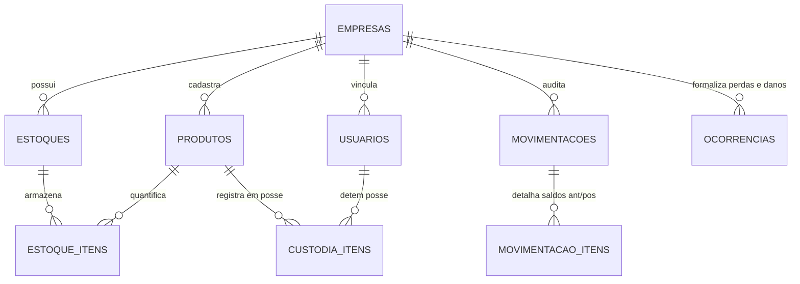

# Sistema de Controle de Estoque, Ferramentas e Custódia

[](https://react.dev/)
[](https://www.typescriptlang.org/)
[](https://vitejs.dev/)
[](https://supabase.com/)
[](#licença)

Sistema web profissional de alta integridade para **controle de estoque, rastreamento de ferramentas e gestão de custódia para equipes de campo**. 

Projetado especificamente para empresas que operam com técnicos externos, veículos utilitários e almoxarifados descentralizados, **eliminando de forma definitiva a conferência manual em pranchetas e planilhas**.

---

## 📌 Sumário

1. [Problema que o Sistema Resolve](#-problema-que-o-sistema-resolve)
2. [Arquitetura Técnica e Segurança](#-arquitetura-técnica-e-segurança)
3. [Modelagem de Dados e Integridade Contábil](#-modelagem-de-dados-e-integridade-contábil)
4. [Estrutura do Projeto](#-estrutura-do-projeto)
5. [Instalação e Execução Local](#-instalação-e-execução-local)
6. [Variáveis de Ambiente](#-variáveis-de-ambiente)
7. [Suíte de Testes Automatizados e Auditoria](#-suíte-de-testes-automatizados-e-auditoria)
8. [Ambiente Demonstrativo (Demo)](#-ambiente-demonstrativo-demo)
9. [Segurança e Row Level Security (RLS)](#-segurança-e-row-level-security-rls)
10. [Roadmap de Próximas Versões](#-roadmap-de-próximas-versões)
11. [Publicação e Repositório Remoto](#-publicação-e-repositório-remoto)

---

## 🎯 Problema que o Sistema Resolve

Em operações de telecomunicações, energia, instalações e manutenção de campo, a saída de materiais do almoxarifado costuma gerar uma "caixa-preta":

* **Falta de visibilidade da posse:** Não se sabe com precisão o que está dentro do veículo de cada técnico vs. o que está fisicamente no depósito central.
* **Perdas e extravios sem auditoria:** Ferramentas caras e sobras de cabos ou conectores são perdidas sem registro circunstanciado.
* **Compras desnecessárias:** Falta de alertas inteligentes provoca compras duplicadas ou, pior, paralisação de equipes por falta de insumos críticos.
* **Conferência manual demorada:** Horas semanais desperdiçadas preenchendo termos de papel e planilhas sujeitas a erro humano.

### A Solução
O sistema implementa uma **custódia rastreável em tempo real**: quando o material sai do almoxarifado, ele é transferido atomicamente para a custódia do técnico. A baixa só ocorre mediante apontamento de **consumo vinculado à Ordem de Serviço**, **devolução ao depósito** ou **registro formal de perda/dano**.

---

## 🏗️ Arquitetura Técnica e Segurança

* **Frontend:** React 19 SPA com TypeScript e Vite.
* **Estilização:** CSS nativo modularizado com Design Tokens (`src/styles/tokens.css`), temas escuro/claro e componentes reutilizáveis acessíveis.
* **Backend:** Supabase com PostgreSQL 15+.
* **Segurança de Dados:** Row Level Security (RLS) estrito com isolamento multi-tenant por empresa (`empresa_id`).
* **Integridade Transacional:** Toda movimentação é processada pela stored procedure transacional `public.processar_movimentacao_estoque`, que utiliza **bloqueio pessimista de linha (`FOR UPDATE`)** e assegura idempotência por chave única.

---

## 📊 Modelagem de Dados e Integridade Contábil



### Regras Fundamentais:
1. **Conservação de Massa/Quantidade:** O somatório físico nunca varia sem justificativa. Para qualquer item:
   $$\text{Saldo Depósitos} + \text{Custódia Técnicos} + \text{Consumidos} + \text{Perdidos} = \text{Total Entrado no Sistema}$$
2. **Escrita Direta Bloqueada:** Nenhum cliente REST pode alterar saldos diretamente via `UPDATE/INSERT` nas tabelas `estoque_itens` ou `custodia_itens`. Apenas funções `SECURITY DEFINER` autorizadas alteram saldos com auditoria automática.
3. **Imutabilidade do Histórico:** Movimentações registradas não podem ser alteradas ou excluídas; correções exigem formalização de **Estorno** ou **Ajuste de Inventário**.

---

## 📁 Estrutura do Projeto

```text
├── public/                 # Recursos estáticos
├── scripts/                # Scripts de seed e automação de apresentação
│   └── seed-demo-presentation.mjs
├── src/
│   ├── components/         # Design System (layout e componentes atômicos de UI)
│   │   ├── layout/         # AppLayout, Header, Sidebar
│   │   └── ui/             # Card, KPICard, Table, Button, Input, Modal, Alert, Badge
│   ├── features/           # Módulos por Domínio de Negócio
│   │   ├── alertas/        # Monitoramento de Ponto de Pedido e Estoque Mínimo
│   │   ├── auth/           # Login e Provedor de Autenticação Supabase
│   │   ├── configuracoes/  # Perfil e Alternância de Tenant
│   │   ├── dashboard/      # Painel Geral de Métricas e Custódias
│   │   ├── empresas/       # Gestão Multi-tenant de Empresas
│   │   ├── estoques/       # Gestão de Almoxarifados e Estoques Móveis (Veículos)
│   │   ├── movimentacoes/  # Entradas, Retiradas, Consumos, Devoluções e Histórico
│   │   ├── produtos/       # Catálogo de Consumíveis e Ferramentas
│   │   └── usuarios/       # Gestão de Técnicos e Administradores
│   ├── lib/                # Cliente Supabase singleton
│   ├── routes/             # Definição de Rotas e Guardas RBAC (ProtectedRoute)
│   ├── styles/             # Design Tokens e Reset Global
│   └── types/              # Definições de Tipagem TypeScript
├── supabase/               # Migrações DDL e DML do Banco de Dados PostgreSQL
│   └── migrations/
├── tests/                  # Suíte de Validação Automatizada e Auditoria
│   ├── helpers/            # Carregador seguro de ambiente (.env)
│   ├── auth-validation.mjs
│   ├── core-modules-validation.mjs
│   ├── dashboard-alerts-validation.mjs
│   ├── demo-flow-validation.mjs
│   ├── full-audit-validation.mjs
│   └── movements-validation.mjs
├── .env.example            # Template de variáveis de ambiente
├── .gitignore              # Proteção rigorosa contra vazamento de segredos
├── package.json            # Scripts e dependências
└── vite.config.ts          # Configurações do Vite
```

---

## 🛠️ Instalação e Execução Local

### Pré-requisitos
* Node.js v18 ou superior instalado.
* NPM instalado.

### 1. Clonar o Repositório
```bash
git clone https://github.com/bernardoaoliveora/arm.git
cd arm
```

### 2. Instalar Dependências
```bash
npm install
```

### 3. Configurar as Variáveis de Ambiente
Copie o arquivo de exemplo:
```bash
cp .env.example .env
```
Edite o arquivo `.env` com a URL e Anon Key do seu projeto Supabase:
```env
VITE_SUPABASE_URL=https://seu-projeto.supabase.co
VITE_SUPABASE_ANON_KEY=sua-chave-publica-anon-key-aqui
```

### 4. Executar o Servidor de Desenvolvimento
```bash
npm run dev
```
Acesse a aplicação no seu navegador: `http://localhost:5173`.

### 5. Build de Produção
Para validar tipagem estática e gerar o bundle otimizado:
```bash
npm run build
```

---

## 🧪 Suíte de Testes Automatizados e Auditoria

O projeto conta com baterias completas de validação executadas diretamente contra a API REST e RPC do Supabase:

| Comando | Descrição do Teste |
| :--- | :--- |
| `npm run test:audit` | **Auditoria Completa (39 cenários):** RLS, cenário dos 100 parafusos, concorrência, idempotência e estorno. |
| `npm run test:demo` | **Validação do Roteiro Demo (11 passos):** Testa o fluxo sequencial da apresentação ao cliente. |
| `npm run test:movements` | **Movimentações (13 cenários):** Retiradas, consumos, devoluções, perdas, danos e transferências cross-company. |
| `npm run test:dashboard` | **Dashboard & Alertas (8 cenários):** Segregação de unidades físicas e cálculo de ponto de pedido. |
| `npm run test:core` | **Módulos Centrais (7 cenários):** Restrições de banco, unicidade de SKU/CNPJ e desativação lógica. |
| `npm run test:auth` | **Autenticação (8 cenários):** Login JWT, permissões RBAC e proteção contra auto-promoção. |
| `npm run seed:demo` | **Povoamento Demonstrativo:** Inicializa o banco com dados demonstrativos coerentes para apresentações. |

---

## 🎭 Ambiente Demonstrativo (Demo)

Para demonstrações e homologações sem necessidade de cadastros manuais, utilize o comando:
```bash
npm run seed:demo
```

### Credenciais Demonstrativas Criadas:
* **Administrador (Gestão Completa):**
  * E-mail: `admin.demo@empresa.com.br`
  * Senha: `Demo@2026!`
* **Técnico 1 (Operações de Campo - Fibra Óptica):**
  * E-mail: `carlos.tecnico.demo@empresa.com.br`
  * Senha: `Demo@2026!`
* **Técnico 2 (Operações de Campo - Infraestrutura):**
  * E-mail: `roberto.tecnico.demo@empresa.com.br`
  * Senha: `Demo@2026!`

---

## 🔒 Segurança e Row Level Security (RLS)

* **Defesa em Profundidade:** A segurança não se limita a esconder botões na interface. Todas as rotas da API Supabase são protegidas por políticas RLS no PostgreSQL.
* **Isolamento Multi-Tenant:** Técnicos e operadores só consultam registros de sua empresa vinculada (`usuario_tem_acesso_empresa()`).
* **Proteção contra Auto-Promoção:** Trigger PL/pgSQL impede que usuários alterem seu próprio perfil para Administrador.
* **Proteção contra IDOR:** Técnicos só podem movimentar materiais sob sua própria custódia pessoal (`p_tecnico_id = auth.uid()`).

---

## 🚀 Roadmap de Próximas Versões

- [ ] **v1.1:** Leitura de Código de Barras e QR Code diretamente pela câmera do smartphone.
- [ ] **v1.2:** Importação automática de XML de Nota Fiscal de Entrada (NF-e).
- [ ] **v1.3:** PWA com cache offline no dispositivo do técnico para apontamentos sem sinal de internet.
- [ ] **v2.0:** Assinatura digital do cliente na conclusão da Ordem de Serviço e integração via Webhooks com ERP.

---

## 📦 Publicação e Repositório Remoto

* **Repositório GitHub:** [https://github.com/bernardoaoliveora/arm.git](https://github.com/bernardoaoliveora/arm.git)
* **Desenvolvedor / Organização:** `bnwebstudio`

---

## 📄 Licença

Este projeto é proprietário. Todos os direitos reservados.
